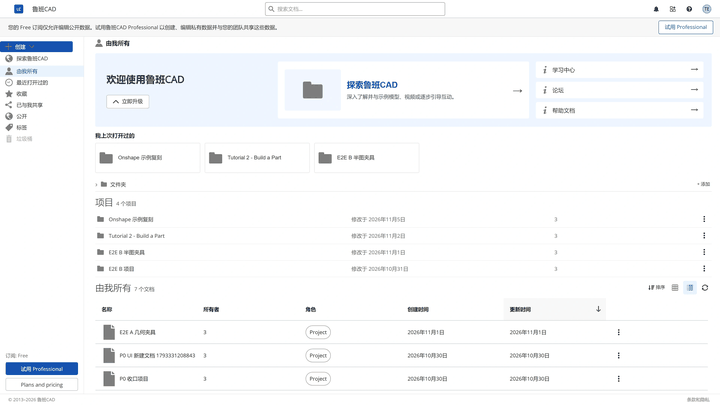
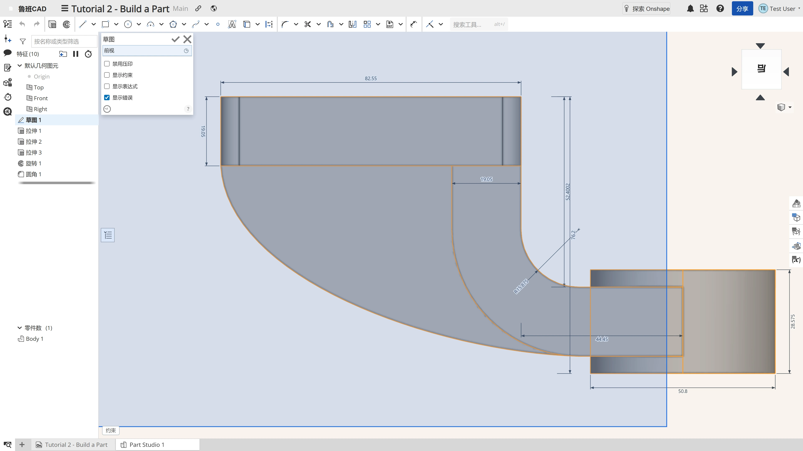
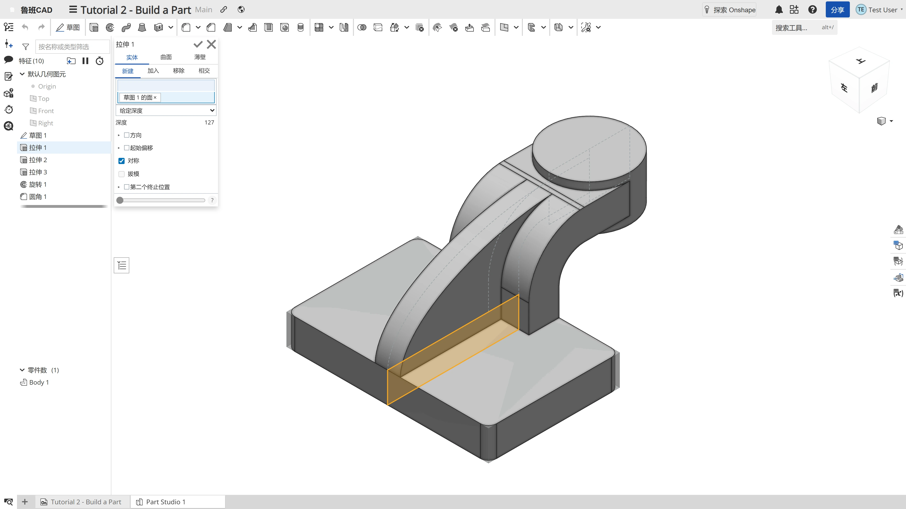
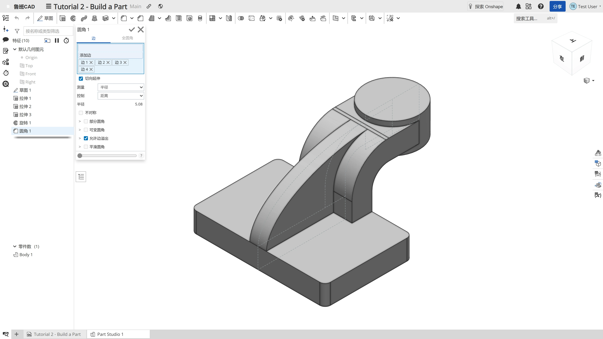
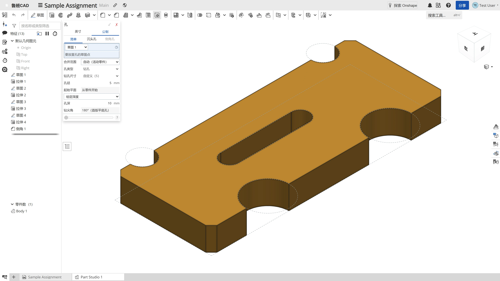
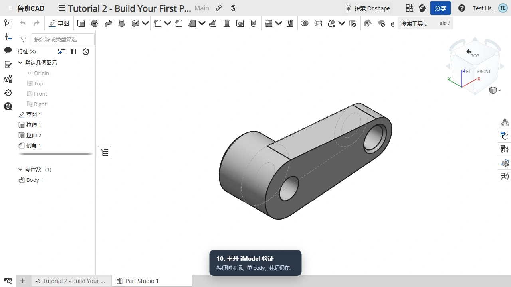
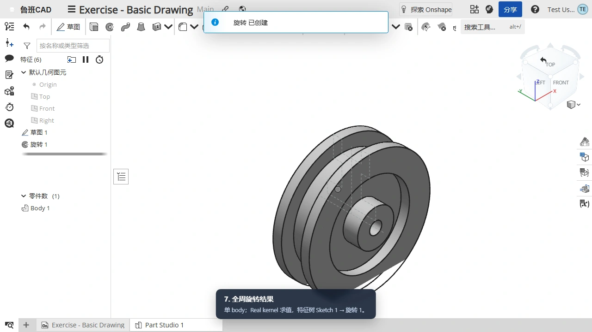
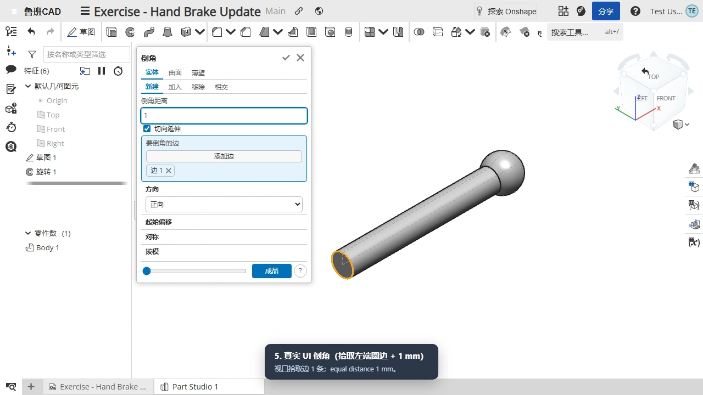

<h1 align="center">天工开物 · 鲁班CAD</h1>

<p align="center"><strong>说出要什么，鲁班给你真形。</strong><br/>
面向工业制造的 AI + CAD 云端参数化设计平台 · 真实 BRep · 可撤销事务 · 真实示例复刻</p>

<p align="center">
  <a href="luban-cad/apps/web/public/showcase/tutorial2-demo-1080p.webm">
    
  </a>
</p>

<p align="center">
  <strong>▶ <a href="luban-cad/apps/web/public/showcase/tutorial2-demo-1080p.webm">观看完整宣传片</a></strong>
  （1080p · 01:21 · 真实鼠标轨迹；上方动图自动循环）&nbsp;·&nbsp;
  <a href="luban-cad/apps/web/public/showcase">4K 实机截图</a>
</p>

> **产品介绍页**：本地栈入口 `http://localhost:5301/`，前端 dev 为 `http://localhost:5300/`；主页即完整宣传片与能力展示（`/showcase` 同内容），无需登录。
> 宣传片完整版在产品主页 `/` 内嵌播放。GitHub README 不支持内嵌仓库内的视频文件，因此 README 使用自动循环的动图预览，点击可打开完整 1080p 视频。

---

## 鲁班CAD 是什么

鲁班CAD 是**生成式 CAD**：面向工业制造，把设计意图变成由 **真形（TrueForm）几何内核**产出的、
可用于制造的 **真实 BRep 实体**，而不是通用文生 3D 的 Mesh。

产品底座是 vendored **iTwin.js / iModel / BIS**：模型、特征树、草图、参数、选择、事务与变更历史
统一落在 iModel 中；前端只是投影与交互层，不另建一套模型事实源。

- **真 BRep，不是网格**：拉伸、旋转、圆角、倒角、孔、布尔等操作真实求值，可测量、可对拍体积。
- **参数化特征链**：草图 + 约束/尺寸 + 特征树；双击树行二次编辑，参数更新走 `updateParams`。
- **云端数据链**：Changeset 推送/历史、写租约、语义 undo/redo、checkpoint/baseline 云化。
- **真实示例复刻**：Onshape 公共示例逐一复刻为持久 iModel，重开逐库校验特征树与体积。
- **可参与的开源面**：`apps/web`、`packages/{viewer,editor,shared}` 与 iTwin.js fork 可独立构建。

## 实机画面（4K）

| 草图与约束 | 参数化特征 |
|---|---|
|  |  |

| BRep 拓扑显示 | 孔与工程特征 |
|---|---|
|  |  |

以上均为 **3840×2160** 实机截图，来自真实栈运行（Tutorial 2 / Sample Assignment），不是概念图。

## 真实示例，真实 iModel，真实体积

| 示例 | 结果 |
|---|---|
| **Tutorial 2 - Build a Part** | 六特征 + 四棱圆角；终体积 **357.739 cm³**，去材 **0.422 cm³**；严格鼠标级复刻 |
| **Tutorial 2 iOS** | **157,478.900 mm³**，与 Onshape 目标 **0.00%** 误差 |
| **Exercise: Basic Drawing** | **2442.2935 mm³**，与目标 **-0.00%** 误差 |
| **Exercise - Hand Brake Update** | 左端圆边 **1 mm** 倒角，真实 UI 拾边 |
| **Sample Assignment** | 4 草图 + 4 拉伸 + 4 竖边距离-角度倒角；**8915.860 mm³** |
| **Exercise: Element Organization** | 一个 iModel 内 2 个 Part Studio 页签：O-Ring 全周旋转、Bushing 拉伸；逐 PS 重开验证 |

<p>
  
  
  
</p>

示例复刻与重开回归：

```bash
cd luban-cad/apps/web
corepack pnpm@10 exec playwright test e2e/examples/verify-imodels.spec.ts
```

## 核心能力

| 域 | 能力 |
|---|---|
| **草图** | 线/矩形/圆/圆弧/样条、构造几何、尺寸与几何约束、DOF/矛盾提示；视口平面拾取 |
| **参数化特征** | 拉伸、旋转、圆角、倒角、孔、cPlane、抽壳、放样、扫掠、镜像、线性/圆周阵列；抑制/排序/试算预览 |
| **工程特征** | 草图点/曲线顶点孔位、简单孔/沉头孔、盲孔/完全贯穿、起始平面、钻尖角；真实布尔去材 |
| **选择与显示** | iTwin 默认渲染 + 全 BRep 拓扑边/顶点叠加；点/边/面统一悬停与拾取；官方 iTwin ViewCube 默认 |
| **版本与协同** | Changeset 提交/推送/历史时间线、命名版本、写租约、语义 undo/redo；冲突解决规划中 |
| **多体与布尔** | NEW-body、body boolean（并/差；交暂禁）、逐 body 可见性、逐 body 颜色（会话内） |
| **AI / Agent** | Agent 复用现有 `toolId`，禁止第二套建模 API；破坏性操作 HITL（预览 → 确认 → 提交） |

## 技术底座

```
浏览器（React 18 + Vite）
   │ 同源入口 :5301（容器内 nginx；开发态 :5300）
   ▼
nginx ─┬─ /api /ws /ipc → modeling-server :5401（Briefcase / FeatureOp / 真形几何内核）
       ├─ /auth /itwins /imodels → iModelHub :5400（用户 / 项目 / 模型 / changeset / 权限）
       ├─ /azurite → Azurite :10500（baseline / changeset / tile / 缩略图）
       └─ / → web（静态）
```

- **数据主权**：iModel/BIS + `params` 是唯一模型事实源；派生显示数据只做投影。
- **单一编辑管道**：参数化建模走 `LubanFeatureRpcInterface` FeatureOp；直接编辑走 iTwin 标准工具 + IPC；事务走 `BriefcaseTxns`/`saveChanges`。
- **内核与求解器**：真形（TrueForm）只经 `SolidKernel.h`；绳墨（ShengMo）保持 solver-neutral；ACIS 仅 Modeler/Polyhedra。
- **UI 与 Onshape 对齐**：Part Studio 壳层、特征对话框、Documents 首页、登录页与 ViewCube 按 live 证据逐区对齐；渲染观感差异由引擎决定。

## 快速开始（外部体验者）

前置：**Windows 10/11 x64**、Docker Desktop（已启动）、Node.js 20.12+（推荐 22 LTS）。**不需要 GitHub 账号，不需要 `gh`，不需要 `docker login`** —— 4 个服务镜像（web / bff / imodelhub / webhook-agent）与 Windows 后端产物均为公开资源（镜像已脱敏，不含私有源码）。

```powershell
git clone --depth 1 https://github.com/chenjinxian/tiangong-kaiwu.git
cd tiangong-kaiwu
powershell -NoProfile -File scripts/quickstart.ps1
```

一键完成：生成 `.env`（随机密钥）→ 匿名下载 modeling-server 产物（SHA256 校验）+ 4 个 GHCR 公开镜像（web / bff / imodelhub / webhook-agent）→ 启动容器栈与宿主后端 → 全栈验收 → 打开 **http://localhost:5301**。

等价的 5 步手动流程：

```powershell
powershell -File scripts/generate-env.ps1     # 生成根 .env（幂等）
powershell -File scripts/fetch-backend.ps1    # 公开 Release 产物 + GHCR 公开镜像
docker compose up -d                          # hub / web / nginx / 基础设施
powershell -File scripts/start-ms-host.ps1 -Detach
powershell -File scripts/verify-stack.ps1     # 全栈验收
```

停止：`docker compose down` + `powershell -File scripts/stop-ms-host.ps1`。首次下载约 5–15 分钟、磁盘约 6–8 GB。当前不支持 Linux/macOS/Apple Silicon（modeling-server 是 Windows 原生宿主进程）。完整说明、升级与故障排查见 [`docs/Deployment-Guide.md`](docs/Deployment-Guide.md) 与 [`docs/README.md`](docs/README.md)。

## 开发与测试

```bash
cd luban-cad && corepack pnpm@10 install
corepack pnpm@10 --filter @luban-cad/shared run build
corepack pnpm@10 --filter @itwin/editor-common --filter @itwin/editor-backend --filter @itwin/editor-frontend run build
corepack pnpm@10 --filter @luban-cad/viewer run build
cd apps/web && corepack pnpm@10 dev          # :5300
```

```bash
# 单测 / 类型 / lint
cd luban-cad/apps/web && corepack pnpm@10 test
corepack pnpm@10 exec tsc --noEmit
corepack pnpm@10 run lint

# 真栈 e2e（需 hub + MS + dev server）
corepack pnpm@10 exec playwright test e2e/documents.spec.ts e2e/part-studio.spec.ts
```

- 当前基线：`apps/web` **1389/1389** 单测；tsc/lint 绿；viewer 127、shared 159。
- iTwin.js fork 改动须登记 `docs/ITWINJS_CORE_MODIFICATIONS.md`，并按 Rush 重建下游产物。
- 后端源码在私有仓，本仓只消费 GHCR 镜像与 GitHub Releases 产物；不提交私有源码/密钥/native 证据。

## 文档与参与

- [产品介绍页实现与 UI 对齐记录](docs/UI-ONSHAPE-PARITY-2026-11-02.md)
- [架构](docs/Architecture.md) · [路线图](docs/ROADMAP.md) · [开发规则](docs/DEVELOPMENT-RULES.md)
- [文档总索引](docs/README.md) · [已删除文档历史](docs/HISTORY.md)
- 相关公开项目：[DanQing](https://github.com/chenjinxian/DanQing)（纯客户端图形引擎）、[DanQing-Data](https://github.com/chenjinxian/DanQing-Data)（演示数据）、[Releases](https://github.com/chenjinxian/tiangong-kaiwu/releases)
- 欢迎 Issue / PR；界面变化请附截图或录屏。私有后端、真形内核、绳墨求解器不在本仓展开。

## 许可与边界

- 本仓公开部分含 iTwin.js fork（原始许可见 `itwinjs-core/LICENSE.md`）。
- 后端服务、真形（TrueForm）几何内核、绳墨求解器为私有仓自研组件，经 GHCR/Releases 产物分发；本仓不含其源码。
- 能力状态以代码与测试实测为准，使用 ✅/🟠/⚪/❌ 标记；未实现能力不伪造 UI 或成功回执。
